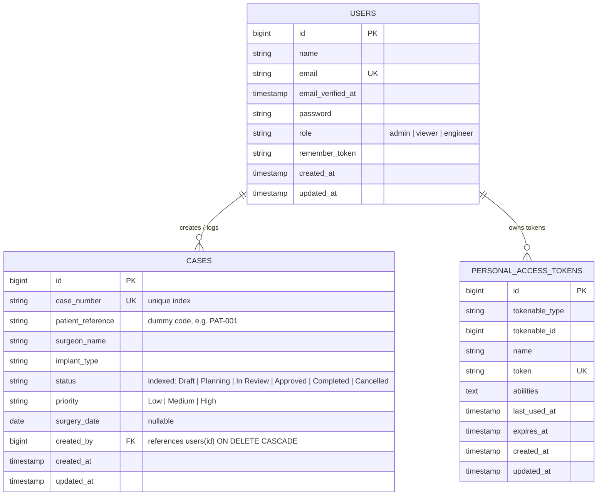

# Medical Case Management — Database Schema & Architecture

## Overview
The Medical Case Management system uses a relational database schema designed for tracking medical device implants, patient surgical workflows, and user authorization.

---

## Entity Relationship (ER) Diagram

---

## Table Definitions

### 1. `users`
Stores user identities and system role permissions.

| Column | Type | Attributes | Description |
|---|---|---|---|
| `id` | `BIGINT UNSIGNED` | Primary Key, Auto-increment | Unique identifier for each user |
| `name` | `VARCHAR(255)` | Not Null | User full name / clinical title |
| `email` | `VARCHAR(255)` | Unique, Not Null | Login email address |
| `email_verified_at` | `TIMESTAMP` | Nullable | Email verification timestamp |
| `password` | `VARCHAR(255)` | Not Null | Bcrypt-hashed password |
| `role` | `VARCHAR(255)` | Not Null, Default `'viewer'` | Role: `admin`, `viewer`, or `engineer` |
| `remember_token` | `VARCHAR(100)` | Nullable | Laravel session remember token |
| `created_at` | `TIMESTAMP` | Nullable | Record creation time |
| `updated_at` | `TIMESTAMP` | Nullable | Record update time |

---

### 2. `cases`
Stores individual implant surgical cases and their lifecycle tracking.

| Column | Type | Attributes | Description |
|---|---|---|---|
| `id` | `BIGINT UNSIGNED` | Primary Key, Auto-increment | Unique internal surrogate identifier |
| `case_number` | `VARCHAR(255)` | Unique Index, Not Null | Clinical reference (e.g. `CASE-1001`) |
| `patient_reference` | `VARCHAR(255)` | Not Null | Anonymized patient reference (dummy code) |
| `surgeon_name` | `VARCHAR(255)` | Not Null | Name of the operating surgeon |
| `implant_type` | `VARCHAR(255)` | Not Null | Medical device specification / model |
| `status` | `VARCHAR(255)` | Index, Not Null | `Draft`, `Planning`, `In Review`, `Approved`, `Completed`, `Cancelled` |
| `priority` | `VARCHAR(255)` | Not Null, Default `'Medium'` | `Low`, `Medium`, `High` |
| `surgery_date` | `DATE` | Nullable | Scheduled surgical operation date |
| `created_by` | `BIGINT UNSIGNED` | Foreign Key, Not Null | References `users.id` with `ON DELETE CASCADE` |
| `created_at` | `TIMESTAMP` | Nullable | Timestamp when case was opened |
| `updated_at` | `TIMESTAMP` | Nullable | Timestamp of latest revision |

---

## Indexing Strategy & Rationale

1. **Unique Index on `cases.case_number` (`cases_case_number_unique`)**:
   - Ensures that duplicate case numbers cannot be inserted even under concurrent race conditions.
   - Accelerates point lookups (`WHERE case_number = ?`) for searches and REST API detail queries.

2. **Index on `cases.status` (`cases_status_index`)**:
   - Speeds up status filtering (`WHERE status = ?`) which powers dashboard aggregate count cards and filtered case listings.

3. **Foreign Key Index on `cases.created_by`**:
   - Enables fast joins when eager-loading case creators (`with('creator')`).
   - Guarantees referential integrity; if a user account is purged, dependent test data cascades cleanly.

---

## Seed Data Summary
The database seeder (`DatabaseSeeder.php`) establishes:
- **1 Admin user**: Full administrative rights (`admin@example.com`)
- **1 Viewer user**: Read-only clinical auditor (`viewer@example.com`)
- **1 Engineer user**: Technical review & status management (`engineer@example.com`)
- **26 Dummy Cases**: Spanning all 6 status values and 3 priority levels with varied surgery dates.
